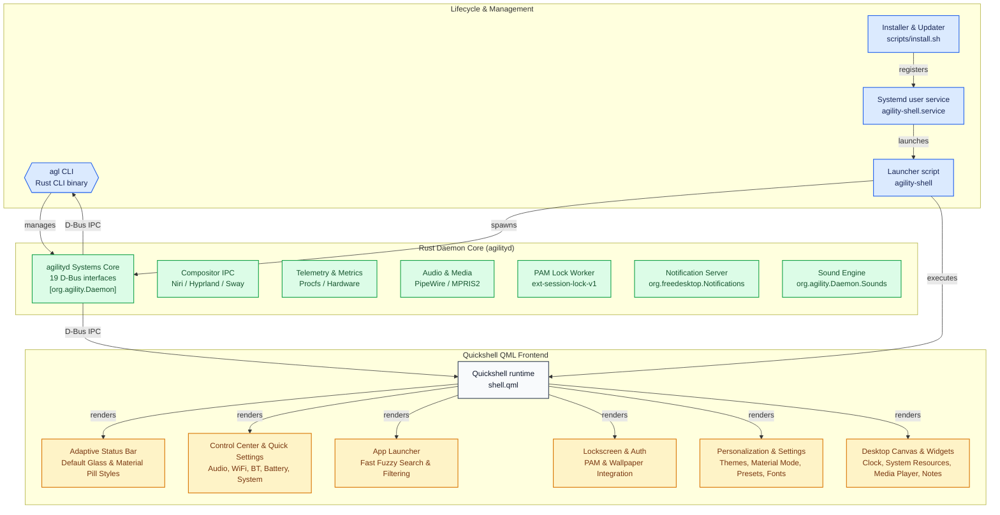

*Agility Shell is a next-generation Wayland desktop shell powered by an ultra-fast Rust daemon (`agilityd`) and a GPU-accelerated Quickshell frontend. Featuring lightweight memory footprint (< 15MB daemon RSS), instant sub-15ms restarts, secure PAM session lock, iconic Doom Melt suite transitions, dual theme engines (Agility Glass & Dynamic Material Theme), animated desktop layout presets, and 100% Rust & QML architecture.*

---

## Key Features

* **Next-Gen Rust Daemon (`agilityd`):** Multithreaded systems core communicating over high-speed D-Bus (`org.agility.Daemon`), delivering sub-2ms launcher responses, sub-4ms workspace switching, and isolated PAM worker threads.
* **Dual Theme Engine:** Switch between Default Glass UI and dynamic Material Design 3 theme with wallpaper-adaptive color schemes.
* **Desktop Layout Presets:** Instant animated switching between 'Full Material Canvas', 'Compact Island', and 'Bottom Waffle Bar' presets, plus custom user arrangements.
* **GPU-Accelerated Quickshell Frontend:** Declarative QML surfaces featuring liquid glass cards, interactive canvas applets with 20px grid-snapping, floating docks, toast notifications, sound effects, and OSD overlays.
* **Low Resource Footprint:** Combined memory under 40 MB RSS (down from 180MB+ in legacy Python), smooth 60 FPS on vintage hardware via `QT_QUICK_BACKEND=software`.
* **Iconic Transitions:** Staggered vertical column Doom Melt screen transitions across monitors when switching desktop suites.
* **Secure Wayland Session Lock:** Native `ext-session-lock-v1` / `WlSessionLock` integration with PAM rate limiting, exponential backoff, and blurred wallpaper backdrop.
* **High-Speed CLI (`agl`):** Lightning-fast command client written in Rust for full system control, sound effects, and status reporting.

---

## Installation & Quick Start

### 1. Check & Install Dependencies (Step-by-Step Doctor)
To test and install every missing dependency one-by-one with interactive prompts:

```bash
curl -fsSL https://raw.githubusercontent.com/TattvaOrg/agility-shell/main/install.sh | bash -s -- --deps
```

### 2. Install Agility Shell (System-Wide)
Once dependencies are satisfied, install Agility Shell into the distributed system directories (`/usr/bin` and `/usr/share`):

```bash
curl -fsSL https://raw.githubusercontent.com/TattvaOrg/agility-shell/main/install.sh | bash
```

> **Fast Prebuilt Install (Default)**: Selecting **Latest Release** (Option 1) directly downloads and installs the official prebuilt binary tarball from GitHub Releases—no local Rust/cargo compilation required. If you prefer compiling from source, select **Compile by yourself** (Option 2) or pass `--from-source`.

>[!NOTE]
>The installer automatically scans `~/.config/agility-shell` for any old monolithic shell installations, removes old source files and venvs, and safely migrates your custom configs, themes, wallpapers, and styles to the new clean config directory.

### 3. Update Agility Shell (One-Liner Delta Update)
To update Agility Shell without re-cloning the entire repository:

```bash
curl -fsSL https://raw.githubusercontent.com/TattvaOrg/agility-shell/main/update.sh | bash
```

> **Channel Selection**: The updater interactively asks whether to update to the **Latest Release** (stable tag) or the bleeding-edge **`main` branch**. It reuses the persistent local repository cache (`~/.cache/agility-shell/repo`), downloads only new commits/deltas instead of full re-clones, compiles updated snippets, and preserves all user configurations (`config.json`, `suits.json`, `style/`, `wallpapers/`).
>
> **Direct Channel Flags**:
> - Update to Latest Release: `curl -fsSL https://raw.githubusercontent.com/TattvaOrg/agility-shell/main/update.sh | bash -s -- --release`
> - Update to Bleeding-Edge Main: `curl -fsSL https://raw.githubusercontent.com/TattvaOrg/agility-shell/main/update.sh | bash -s -- --main`
> - Or directly from terminal: `agl update`

### 4. Uninstall Agility Shell
To uninstall Agility Shell, use `agl uninstall` or see the [Uninstallation Guide](more.md#uninstallation).

---

## In-Depth Architecture & Reference Guide

For comprehensive documentation, filesystem specifications, CLI command references, and compositor autostart guides, refer to **[more.md](more.md)**:

* **[Architecture Highlights & Performance Targets](more.md#architecture-highlights)**
* **[Filesystem Layout & Architecture ("Where & Why")](more.md#filesystem-layout--architecture-where--why)**
* **[Complete `agl` CLI Command Reference](more.md#cli-management-agl)**
* **[Maintenance Scripts & Wrappers](more.md#maintenance-scripts-scripts)**
* **[Uninstallation Procedures](more.md#uninstallation)**
* **[Configuration & Compositor Autostart (Niri, Hyprland)](more.md#configuration--autostart)**

---

## Controlling Applets (IPC Syntax)

Agility Shell delegates keyboard shortcut assignments to your host window manager. You can toggle applets smoothly via an Inter-Process Communication (IPC) layer using `agl toggle` or D-Bus:

```ini
# Example: Toggle surfaces via agl CLI
Mod+Space { spawn "agl" "toggle" "launcher"; }
Mod+N     { spawn "agl" "toggle" "notifications"; }
```



---

## Contributing & Credits

Contributions are always welcome! Please check the issues tab, follow our descriptive branching workflow, and submit a pull request.

Special thanks and attributions to:
- **[dots-hyprland](https://github.com/end-4/dots-hyprland)**: For the magnificent Material You / Material Design 3 UI concepts, widget designs, and dynamic color styling.
- **[Minflair](https://github.com/t4lentles5/minflair)**: The modular Quickshell QML frontend architecture to use as Agility's new Rust + QML releases.
- **[caffyne-shell](https://github.com/caffyne-org/caffyne-shell)**: For foundational ideas and inspiration and python based desktop shell (Agility's older versions).
